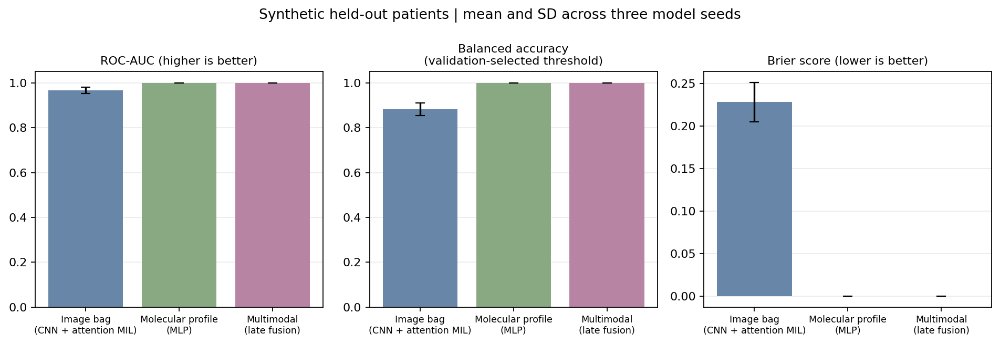

# Multimodal Liver Pathology Sandbox

An **AI-assisted learning project** that implements a small, reproducible pipeline. It compares an image-bag model, a molecular-profile model, and late fusion of both modalities.

Project owner: Pavan Gupta. Codex assisted with the study design, implementation, experiment execution, and documentation. Review and reproduce the work before presenting it as personal experience. This repository is a learning artifact, not independently authored applicant research.

## Scope

The posting describes whole-slide image curation, deep learning, self-supervised learning and/or multiple instance learning, molecular data integration, interpretability, and careful evaluation. This sandbox focuses on one manageable slice: a CNN encoder with gated attention MIL for bags of image patches, a small MLP for paired molecular-style features, and late fusion.

All inputs and labels are **synthetic**. The pink and purple toy patches are procedural pixels, not histology. The profile vectors are random numbers with a controlled latent signal, not gene expression. The target is a made-up binary latent state, not MASH, ASH, HCC, progression, or any clinical outcome. No clinical conclusions can be drawn from this benchmark.

## Run

Python 3.10 to 3.12 is recommended. Install the dependencies and run the full experiment:

```powershell
python -m venv .venv
.\.venv\Scripts\Activate.ps1
python -m pip install -r requirements.txt
python multimodal_liver.py --output results/main
```

The run creates 360 synthetic patient IDs with eight patches and 18 profile features each. It makes fixed, stratified train/validation/test splits at the patient level, trains three model variants for three initialization seeds, selects checkpoints by validation loss, and evaluates once on the held-out test set. The models use a maximum of 14 epochs with early stopping.

For a quicker run:

```powershell
python multimodal_liver.py --output results/quick --patients 120 --epochs 4
```

## Results

The recorded experiment is summarized in [results/main/RESULTS.md](results/main/RESULTS.md). The plot compares ROC-AUC, balanced accuracy and Brier score across the three model variants. Error bars show SD across three model initialization seeds on the same fixed synthetic test patients, not uncertainty over real patients or independent datasets.



The repository also records raw per-seed metrics, training and validation losses, validation and synthetic test predictions, a patient-split hash manifest, package versions and runtime. Balanced accuracy uses a threshold selected on validation data; a separate 0.5-threshold value is also reported. One synthetic bag shows weights from the image-only model. Attention weights are not validated explanations of biological mechanisms.

## Reproducibility and limits

- No external dataset download is required and no patient data are included.
- Train, validation and test contain disjoint synthetic patient IDs. The code writes hashes and overlap status to `split_manifest.json`.
- Checkpoints are selected using validation BCE, and classification thresholds are selected using validation balanced accuracy. The test split is used only for final scoring.
- The three seeds vary model initialization and minibatch ordering. They do not provide independent cohorts or confidence intervals.
- The simulator intentionally makes both modalities informative. Results mostly show that the code can fit this constructed task; they do not establish an advantage for multimodal fusion in real pathology.
- The attention visualization is included for inspection, not as a clinically faithful explanation.
- No whole-slide image tiling, stain normalization, real molecular assay integration, external validation, missing-modality study, pathology review, or clinical prediction is implemented.

See [LEARNING_GUIDE.md](LEARNING_GUIDE.md) before discussing the model in an interview.

## References

- KU Leuven position: [PhD position in AI and multimodal digital liver pathology](https://academicpositions.com/ad/ku-leuven/2026/phd-position-in-ai-and-multimodal-digital-liver-pathology/253989).
- Ilse, Tomczak, and Welling (2018), [Attention-based Deep Multiple Instance Learning](https://proceedings.mlr.press/v80/ilse18a.html).
- Campanella et al. (2019), [Clinical-grade computational pathology using weakly supervised deep learning on whole slide images](https://doi.org/10.1038/s41591-019-0508-1).

MIT License. The synthetic data generator and code are provided for learning and reproducibility.
